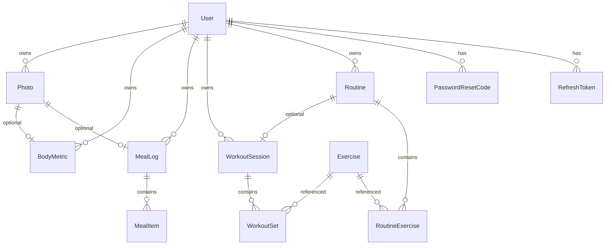
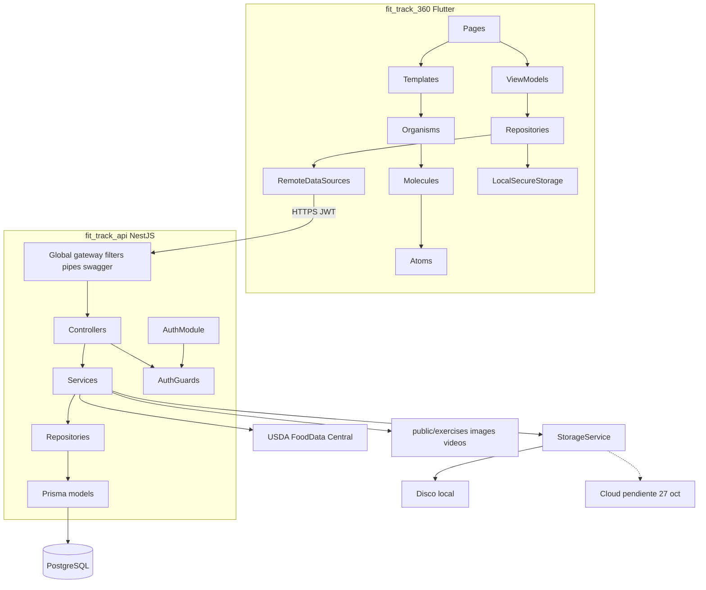
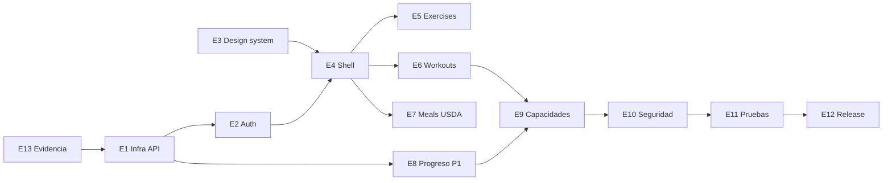

# Plan maestro FitTrack360

Documento de arquitectura y roadmap para el proyecto integrador (Flutter + NestJS). No implementa código: define dominio, capas, fases, epics y trazabilidad al enunciado para derivar tasks de GitHub Projects.

| Campo | Valor |
| --- | --- |
| Producto | FitTrack360 |
| Versión del plan | 1.1 |
| Fecha | 20 oct 2026 |
| Frontend | `fit_track_360` (Flutter, MVVM + Atomic Design, Liquid Glass dark) |
| Backend | `fit_track_api` (NestJS por capas, PostgreSQL, Prisma, Docker, Swagger) |
| Caso | Entrenamiento + alimentación + guía de ejercicios con GIFs |
| Equipo | 6 integrantes (optativas = 6 pts) |
| Fuentes | `docs/context/proyecto-integrador_enunciado.md`, `docs/context/3_JUSTIFICACION_10C.md`, `docs/context/3_MISION-VISION-VALORES_10C.md`, `docs/context/3_FITTRACK360_TRAMITES Y PERMISOS.md`, `docs/context/EQUIPO3_FODA ESTRATEGICO_ESTUDIO COMPETENCIA.md`, `fit_track_360/docs/design-system.md` |

---

## 1. Visión y dominio

### 1.1 Problema

Personas que entrenan y cuidan su alimentación necesitan un solo lugar para registrar sesiones, macros y consultar técnica de ejercicios con media visual, sin pretender sustituir atención médica o nutricional.

### 1.2 Tres pilares (MVP cuatrimestre)

1. **Entrenamientos:** rutinas (plantillas), sesiones, series/reps/carga, historial.
2. **Alimentación:** registro de comidas, calorías/macros, búsqueda de alimentos.
3. **Guía de ejercicios:** catálogo del seed (1324) con thumbnail + GIF servidos por el API (`fit_track_api/seed/exercises.es.json`, media en `public/exercises/images/` y `public/exercises/videos/`).

### 1.3 Entidades de dominio (F2)

| Entidad | CRUD nube | Dueño | Notas |
| --- | --- | --- | --- |
| `WorkoutSession` | Sí | `userId` | Sesión de entrenamiento: fecha, ejercicios, series, reps, carga, ubicación opcional (P2) |
| `MealLog` | Sí | `userId` | Comida registrada: alimentos, macros, foto opcional (P1) |
| `Routine` | Sí | `userId` | Plantilla de rutina del usuario (Fase 3); auxilia a workouts |
| `Exercise` | Lectura | Catálogo | Seed + estáticos; no CRUD de usuario |
| `User` / perfil | Parcial | `userId` | Perfil, preferencias, interruptores de notificaciones, consentimiento de privacidad |
| `BodyMetric` / progreso | Sí | `userId` | Métricas y fotos de progreso (P1) |

Las dos entidades con CRUD completo del usuario autenticado (`WorkoutSession`, `MealLog`) cumplen F2. `Routine` refuerza el módulo central de la justificación. Las demás son auxiliares.

### 1.4 API de terceros (F3)

- **Proveedor elegido:** USDA FoodData Central (FDC).
- **Endpoint:** `GET https://api.nal.usda.gov/fdc/v1/foods/search`.
- **Credencial:** `USDA_FDC_API_KEY` solo en `.env` / secrets Docker (S3). Prohibido `DEMO_KEY` en el repositorio.
- **Timeout:** 5 s. Manejo de error en un servicio dedicado detrás de repositorio/proxy.
- **Mapeo de nutrientes:** 1008 kcal, 1003 proteína, 1004 grasa, 1005 carbohidratos.
- **Cliente Flutter:** no llama a USDA directo; consume el endpoint del API propio.
- **Degradación:** si la API falla o no hay resultados, el usuario puede capturar un alimento manual (nombre + macros). Cubre la prueba con datos inválidos y la UX en español.
- **Limitación documentada:** la búsqueda funciona en inglés (datos de EE. UU., CC0).
- **Descartados:** Nutritionix (sin tier gratuito para estudiantes; planes desde ~US$499/mes) y Edamam (sin plan gratuito usable). No reabrir esas opciones en el cuatrimestre.

### 1.5 Media de ejercicios y atribución

- Rutas reales: `fit_track_api/public/exercises/images/` (1324 JPG 180x180) y `public/exercises/videos/` (1324 GIF 180x180), ~131 MB.
- Seed: `fit_track_api/seed/exercises.es.json` (campos: `id`, `name` en inglés, `category`, `body_part`, `equipment`, `target`, `muscle_group`, `secondary_muscles`, `instructions_es`, `instruction_steps_es`, `image`, `gif`, `media_id`, `attribution`).
- Licencia de media (`public/exercises/NOTICE.md`): atribución obligatoria **© Gym visual - <https://gymvisual.com/>** en cada uso; resolución máxima 180x180. Clonar el repo no otorga licencia comercial.
- En UI: mostrar `attribution` en el detalle de cada ejercicio. Etiquetas `body_part` / `equipment` / `target` se traducen con un mapa constante en `features/exercises`. El `name` se muestra en inglés (el seed no trae traducción; limitación documentada).
- Despliegue: la media se incluye en la imagen Docker (solo lectura, versionada) y se sirve con `@nestjs/serve-static` en `/static/exercises/images/{image}` y `/static/exercises/videos/{gif}`. Los uploads de usuario van aparte (volumen u objeto).

### 1.6 Capacidades de dispositivo

| ID | Uso en FitTrack360 | Pts |
| --- | --- | --- |
| P1 | Foto de progreso corporal o de comida; comprimir y subir con acceso restringido al dueño | Base |
| P2 | Al cerrar sesión de workout, registrar "entrené en este gimnasio/zona"; si GPS apagado, lista de zonas. Solo `ACCESS_COARSE_LOCATION` | Base |
| P3 | Recordatorio local de entrenamiento o comida (programación inexacta, sin `SCHEDULE_EXACT_ALARM`); interruptor en Ajustes | Base |
| O1 | Biometría para desbloquear sesión o confirmar acción sensible; alternativa PIN/contraseña | 2 |
| O5 | Pasos del día (ACTIVITY_RECOGNITION / motion) en resumen diario del Home | 2 |
| O7 | Elegir contacto (selector del sistema, sin `READ_CONTACTS`) y abrir `https://wa.me/` o `sms:` con mensaje de progreso | 1 |
| O10 | Compartir resumen de sesión o día con `share_plus` | 1 |

Total optativas: **6 pts**. Base P1–P3 no suma. Cada capacidad vive detrás de un servicio propio sustituible en pruebas. Las optativas se anuncian en el PR de `docs/permisos.md` antes de H3 (el enunciado permite cambiarlas solo hasta H3).

### 1.7 Distribución y backend de entrega

- Android: APK + AAB firmados (SemVer + build).
- iOS y AppGallery: **solo se documentan** (expediente); el enunciado no exige IPA.
- Backend: Docker Compose (`api` + `postgres` + Mailpit en desarrollo) + Swagger en `/api/docs`.
- Keystore, secrets y `.env` nunca en el repo (S3).
- Destino en la nube: **pendiente del equipo** (fecha límite 27 oct 2026). Criterios: HTTPS público, Postgres persistente, almacenamiento de fotos con acceso solo del dueño, costo cero o crédito estudiantil. Opciones: VPS + Compose + Caddy; PaaS + Postgres administrado + R2/Cloudinary; Supabase. El código usa interfaz `StorageService` con driver de disco local desde Fase 0; driver S3-compatible solo si gana una PaaS.

### 1.8 Privacidad y límite profesional

Según trámite 11 (LFPDPPP) y estrategias FA2 / DA2 del FODA:

- Casilla de consentimiento expreso en el registro (`privacyConsentAt`, `privacyNoticeVersion`).
- Aviso de privacidad simplificado in-app (S6).
- ARCO acceso: `GET /users/me/export`.
- ARCO cancelación: `DELETE /users/me` con cascada y borrado de archivos (también exigido por Google Play).
- Aviso visible: la app **no emite prescripciones médicas ni nutricionales**.
- Re-encode de fotos con `sharp` en el servidor para quitar EXIF/GPS.

### 1.9 Fuera de alcance de este documento

- Implementar código de app, Docker real o issues en GitHub Projects.
- Precio o reglas de freemium premium.
- Claims clínicos o sustitución de atención médica/nutricional.

---

## 2. Modelo de datos



| Entidad | Campos principales |
| --- | --- |
| `User` | `id` uuid, `email` único, `passwordHash`, `displayName`, `privacyConsentAt`, `privacyNoticeVersion`, `createdAt`, `updatedAt` |
| `RefreshToken` | `id`, `userId`, `tokenHash`, `expiresAt`, `revokedAt`. Se rota en cada refresh; se revoca en logout |
| `PasswordResetCode` | `id`, `userId`, `codeHash`, `expiresAt`, `usedAt` |
| `Exercise` | `id` string (`"0001"`), `name`, `bodyPart`, `equipment`, `target`, `muscleGroup`, `secondaryMuscles[]`, `instructionsEs`, `instructionStepsEs[]`, `imageFile`, `gifFile`, `attribution` |
| `Routine` | `userId`, `name`, `notes` |
| `RoutineExercise` | `routineId`, `exerciseId`, `position`, `targetSets`, `targetReps` |
| `WorkoutSession` | `userId`, `routineId?`, `startedAt`, `endedAt?`, `notes`, `latApprox?`, `lngApprox?`, `zoneLabel?` |
| `WorkoutSet` | `sessionId`, `exerciseId`, `setIndex`, `reps`, `weightKg` |
| `MealLog` | `userId`, `eatenAt`, `mealType` (`BREAKFAST` / `LUNCH` / `DINNER` / `SNACK`), `notes`, `photoId?` |
| `MealItem` | `mealLogId`, `fdcId?`, `name`, `servingG`, `kcal`, `proteinG`, `carbsG`, `fatG`. Valores guardados como copia; no dependen de USDA después |
| `BodyMetric` | `userId`, `measuredAt`, `weightKg`, `bodyFatPct?`, `waistCm?`, `photoId?` |
| `Photo` | `userId`, `kind` (`PROGRESS` / `MEAL`), `storageKey`, `mimeType`, `sizeBytes`, `width`, `height` |

**Regla S4:** todo recurso de otro usuario responde **404**, no 403.

---

## 3. Arquitectura objetivo



Principios:

- Flutter: vista → ViewModel → repositorio → datasource; carpetas por feature.
- Nest: Controller → Service → Repository → Prisma; guards JWT; políticas por `userId` (S4).
- Tráfico HTTPS (S2); tokens solo en almacenamiento seguro del dispositivo (S1).
- `gateway/` es capa HTTP in-process (rate-limit, request-id, versionado). **No** es un `@WebSocketGateway`.

---

## 4. Backend NestJS (`fit_track_api`)

### 4.1 Estructura de carpetas

```text
fit_track_api/
  prisma/
    schema.prisma
    seed.ts
    migrations/
  src/
    main.ts                 # bootstrap, Swagger, CORS, ValidationPipe global
    app.module.ts
    config/                 # ConfigModule + validación de env (sin secrets en repo)
    common/                 # filters, interceptors, DTOs base, mapeo de errores
    gateway/                # rate-limit, request-id, versionado /api/v1 (HTTP in-process)
    auth/                   # register, login, refresh, logout, forgot/reset password
    users/
    mail/                   # nodemailer + plantillas; Mailpit en desarrollo
    exercises/              # seed + list/detail + URLs image/gif
    workouts/
    routines/
    meals/                  # MealLog + proxy USDA FDC
    progress/               # métricas / metadata de fotos
    storage/                # StorageService (disco local; S3-compatible si aplica)
    database/               # PrismaModule / PrismaService
```

### 4.2 Patrones y seguridad

| Tema | Decisión |
| --- | --- |
| ORM | **Prisma** (`prisma/schema.prisma`, migraciones, seed en `prisma/seed.ts`). Al instalar: agregar `prisma`, `@prisma/client`, `@prisma/engines` a `allowBuilds` en `pnpm-workspace.yaml` |
| Capas | Repository + Service + Controller |
| Validación | DTOs con `class-validator` (paridad con validación cliente, F5/S7) |
| Auth | JWT access + refresh; passwords con `@node-rs/argon2` |
| Recuperación | SMTP vía nodemailer; Mailpit en compose de desarrollo; código de 6 dígitos hasheado, vigencia 15 min; respuesta 200 siempre (no revela existencia de email) |
| Autorización | Filtrado y ownership por `userId`; 404 si no es dueño (S4) |
| Swagger | `@nestjs/swagger`, UI en `/api/docs`, tags por módulo |
| Throttler | En `auth/*` y `foods/search` |
| Errores | Filtro global `{ code, message }`; sin stack en producción (S5) |
| Dependencias | Vigentes y publisher verificado (S8) |

### 4.3 Docker

- `Dockerfile` multi-stage para la API (incluye `public/exercises` en la imagen, solo lectura).
- `docker-compose.yml`: servicios `api`, `postgres`, `mailpit` (dev); volúmenes para uploads de usuario.
- Variables documentadas en `.env.example` (nunca `.env` real en git).

### 4.4 Endpoints (`/api/v1`)

| Área | Endpoints mínimos |
| --- | --- |
| Auth | `POST auth/register`, `auth/login`, `auth/refresh`, `auth/logout`, `auth/password/forgot`, `auth/password/reset` |
| Users | `GET/PATCH/DELETE users/me`, `GET users/me/export` |
| Exercises | `GET exercises` (filtros `bodyPart`, `equipment`, `target`, `q`, paginación), `GET exercises/:id` |
| Routines | CRUD `routines` |
| Workouts | CRUD `workouts` |
| Meals | CRUD `meals` |
| Foods | `GET foods/search?q=` (proxy USDA FDC) |
| Progress | CRUD `progress/metrics` |
| Photos | `POST photos` (multipart), `GET photos/:id` (ownership) |
| Health | `GET health` |
| Estáticos | `/static/exercises/images/{image}`, `/static/exercises/videos/{gif}` |
| Docs | Swagger en `/api/docs` |

---

## 5. Frontend Flutter (`fit_track_360`)

### 5.1 Estructura de carpetas

```text
fit_track_360/lib/
  main.dart
  app/                    # MaterialApp, router, theme (tokens DS)
  core/                   # network (dio), errors, AsyncState sealed, secure storage, connectivity
  design_system/
    tokens/
    atoms/                # BrandPill, badges, text styles, icons
    molecules/            # OptionTile, StatusBanner, PrimaryButton, TextField glass
    organisms/            # GlassSurface, cards tipo QuestionBlock, PageHeader
    templates/            # AppScaffoldTemplate, FormPageTemplate
  features/
    auth/
    home/
    workouts/
    routines/
    exercises/            # guía GIF + mapa de traducción de etiquetas
    meals/
    progress/
    settings/             # perfil, privacidad, permisos, notificaciones, ARCO, biometría
  shared/
```

Cada feature:

```text
features/<nombre>/
  data/           # models, datasources, repository impl
  domain/         # entities, repository contracts
  presentation/   # pages, viewmodels, widgets locales
```

### 5.2 Decisiones FE

| Tema | Decisión |
| --- | --- |
| Arquitectura | MVVM + Atomic Design |
| Estado | **ChangeNotifier + `provider`** (patrón MVVM de la guía oficial de Flutter). Ratificar en tarea 02 antes de cerrar Fase 0. Sealed `AsyncState<T>` en `core/` |
| Navegación | `go_router` |
| HTTP | `dio` (interceptor de refresh) |
| Estados remotos | Sealed: `Loading` \| `Data` \| `Error` \| `Empty` (F6) |
| Offline | `connectivity_plus` + banner reintentar (F7) |
| Sesión | Access/refresh en `flutter_secure_storage` (S1) |
| Base URL | `--dart-define-from-file=env/<ambiente>.json`; `env/*.json` ignorado; `env/example.json` versionado |
| Android debug | Cleartext solo en debug (`src/debug/res/xml/network_security_config.xml` para `10.0.2.2`) |
| Tema | Solo dark Liquid Glass; sin tema light |
| UI | Pressed ≠ Selected; sin BoxShadow inset; blur vía `BackdropFilter` (sigma 16/24) |

### 5.3 Paquetes candidatos (validar S8 en pub.dev al integrar; registrar en `docs/permisos.md`)

`provider`, `go_router`, `dio`, `flutter_secure_storage`, `connectivity_plus`, `image_picker`, `geolocator`, `permission_handler`, `flutter_local_notifications` + `timezone`, `local_auth`, `pedometer`, `share_plus`, `url_launcher`, selector de contacto del sistema (sin `READ_CONTACTS`).

### 5.4 Design system (Liquid Glass)

Referencia: `fit_track_360/docs/design-system.md`.

- Fondo: `bg.deep` / `bg.mid` + vignettes; texto `text.primary` / `secondary` / `muted`.
- Superficies: `GlassSurface` (fill diagonal, border, rim superior con `Stack`/`Positioned`, sombra exterior).
- CTA: relleno blanco/plata, texto `text.onAccent`.
- Componentes base a portar: tokens, `BrandPill`, `StatusBanner`, `OptionTile`, `PrimaryButton`, campos glass, `PageHeader`, templates de scaffold/form.

### 5.5 Mapa de pantallas mínimas (F4: ≥6)

1. Splash / restore sesión  
2. Login / Registro (con consentimiento de privacidad) / Recuperar contraseña  
3. Home (resumen día: workout + macros + pasos O5)  
4. Entrenamientos (lista + detalle sesión + crear/editar; rutinas en Fase 3)  
5. Catálogo de ejercicios (filtros + detalle con GIF + atribución)  
6. Alimentación (logs + búsqueda USDA + captura manual)  
7. Progreso (métricas + fotos P1)  
8. Perfil / Ajustes (aviso de privacidad S6, exportar datos, borrar cuenta, aviso de no prescripción, permisos, notificaciones P3, biometría O1)

---

## 6. Fases de desarrollo (calendario real)

Hoy: **20 oct 2026 (S08)**. H2 (16 oct) ya pasó sin F1 ni P1 en el repo; las Fases 0 y 1 se ejecutan en paralelo como recuperación.

| Fase | Hito / fechas | Objetivos | Criterios trazables |
| --- | --- | --- | --- |
| 0 | 20–27 oct (paralelo con F1) | Estructura FE/BE, Docker+Postgres+Mailpit, Swagger vacío, theme tokens, Prisma base; husky/pnpm ya en monorepo | Infra lista para Auth |
| 1 | 20–27 oct (recuperación H2) | Auth F1 + esqueleto navegable por capas + P1 + borrador `docs/permisos.md` + optativas anunciadas | F1, P1, arquitectura capas |
| 2 | hasta 30 oct (H3) | CRUD workouts + meals en nube con reglas user + P2 + P3 | F2, S4, P2, P3 |
| 3 | hasta 12 nov (H4) | F1–F7, S1–S8, USDA FDC, catálogo GIFs, rutinas, optativas ≥50% pts | F1–F7, S1–S8, F3, O≥3 pts |
| 4 | 27 nov (H5) y 4 dic (H6) | Pruebas 8U/4W/1I; builds debug/release; permisos 3 estados; optativas 100% | Sec. 5 y 4.2 enunciado |
| 5 | 7–11 dic (H7) | APK/AAB firmados, Docker prod, expediente distribución (iOS/AppGallery documentados), defensa | Sec. 6 enunciado |

### 6.1 Detalle por fase

#### Fase 0 - Pre-H2 / recuperación

- Crear árbol de carpetas Nest y Flutter según secciones 4 y 5.
- `docker-compose` con Postgres y Mailpit saludables; API arranca y expone `/api/docs`.
- Prisma: schema inicial + primera migration.
- Theme Flutter con tokens del DS (sin features de negocio).
- Decidir o dejar registrado el destino en la nube (límite 27 oct).
- Criterio de aceptación: `compose up` + app abre splash/home placeholder con tema dark.

#### Fase 1 - H2 recuperación

- Módulos `auth` + `users` + `mail` (API) y feature `auth` (Flutter).
- Router con rutas auth vs app; restore de sesión al reabrir.
- Consentimiento de privacidad en registro.
- Servicio cámara/galería + subida mínima ligada a progreso o meal (P1).
- Borrador `docs/permisos.md` con filas P1 y optativas anunciadas.
- Criterio: demo registro/login/logout/restore + capturar foto comprimida.

#### Fase 2 - H3

- CRUD `WorkoutSession` y `MealLog` con ownership (S4).
- P2 al cerrar workout; P3 recordatorio + switch en Ajustes.
- Criterio: otro usuario no lee/edita recursos ajenos (404); ubicación y notificación demostrables.

#### Fase 3 - H4

- Completar F3–F7, S1–S8, catálogo exercises+GIF, `Routine`, Home con pasos (O5) al menos a mitad de optativas.
- Criterio: checklist Unidad II en demo + código.

#### Fase 4 - H5–H6

- Suite: 8 unitarias, 4 widget (incl. permiso denegado y estados carga/error), 1 integración; un comando.
- `docs/pruebas.md`, `docs/permisos.md` completo, manifiesto fusionado revisado.
- Criterio: CI o script local verde; evidencia 3 estados en físico para P1/P2.

#### Fase 5 - H7

- Binarios firmados (APK/AAB), `docs/distribucion/`, política de privacidad URL, documentación iOS/AppGallery, defensa oral por responsable de capacidad.

---

## 7. Epics (base para `/github-backlog`)

Cada epic lista subtareas técnicas, dependencias, fase y criterios de aceptación. No abrir issues hasta el siguiente paso de backlog.



### Epic 1 - Infra API (Docker, Postgres, config, Swagger, gateway)

- **Depende de:** Epic 13 (plantillas de docs iniciadas).
- **Fase:** 0.
- `Dockerfile` multi-stage + `docker-compose.yml` (`api`, `postgres`, `mailpit`).
- `config/` con validación de env; `.env.example`.
- `main.ts`: ValidationPipe, CORS, Swagger `/api/docs`.
- `gateway/`: request-id, rate-limit básico, prefijo `/api/v1`.
- Prisma + primera migration; health `GET /api/v1/health`.
- Media de ejercicios en imagen; `serve-static` en `/static/exercises/...`.
- **Criterios de aceptación:**
  - [ ] `docker compose up` levanta api + postgres + mailpit.
  - [ ] `/api/docs` responde con documento Swagger vacío o con health.
  - [ ] Un GIF de ejemplo es accesible por URL estática.

### Epic 2 - Auth + usuarios + secure session

- **Depende de:** Epic 1.
- **Fase:** 1.
- Endpoints register, login, refresh, logout, password/forgot, password/reset (SMTP real + Mailpit en dev).
- Hash con `@node-rs/argon2`; JWT access + refresh con rotación.
- Consentimiento de privacidad en register.
- Flutter: pantallas auth, `flutter_secure_storage`, restore en splash (F1, S1).
- Guards en Nest; interceptor dio con refresh.
- **Criterios de aceptación:**
  - [ ] Registro, login, logout y restore al reabrir funcionan en demo.
  - [ ] Forgot/reset con código de 6 dígitos llega a Mailpit; respuesta 200 aunque el email no exista.
  - [ ] Tokens no aparecen en SharedPreferences ni en logs.

### Epic 3 - Design system Flutter

- **Depende de:** - (puede ir en paralelo con Epic 1).
- **Fase:** 0–1.
- Portar tokens a Dart (`Color`/`TextStyle`/`EdgeInsets`).
- Atoms, molecules, organisms y templates (`AppScaffoldTemplate`, `FormPageTemplate`).
- ThemeData dark-only cableado en `app/`.
- **Criterios de aceptación:**
  - [ ] Splash/home placeholder usa tokens Liquid Glass.
  - [ ] Pressed y Selected son estados distintos; sin BoxShadow inset.

### Epic 4 - Shell app (router, AsyncState, connectivity)

- **Depende de:** Epics 2 y 3.
- **Fase:** 1.
- `go_router` con rutas auth/app/settings.
- Sealed `AsyncState` compartido (F6).
- `connectivity_plus` + banner offline + reintentar (F7).
- Cliente dio central (base URL por `--dart-define-from-file`).
- Ratificar `provider` + ChangeNotifier (tarea 02) antes de cerrar Fase 0.
- **Criterios de aceptación:**
  - [ ] Navegación auth ↔ app tras login/logout.
  - [ ] Modo avión muestra banner y permite reintentar sin crash.

### Epic 5 - Módulo Exercises (seed, estáticos, list/detail GIF)

- **Depende de:** Epic 4.
- **Fase:** 0–3 (seed/estáticos desde Fase 0; UI completa en Fase 3).
- Seed load desde `seed/exercises.es.json` vía Prisma seed.
- API list/detail con filtros.
- Flutter: lista + detalle con GIF + atribución; estados Loading/Data/Error/Empty.
- Mapa de traducción de etiquetas; `name` en inglés documentado.
- **Criterios de aceptación:**
  - [ ] Listado filtra por bodyPart/equipment/target.
  - [ ] Detalle muestra GIF, instrucciones en español y atribución Gym visual.

### Epic 6 - Módulo Workouts (+ Routines en Fase 3)

- **Depende de:** Epic 4.
- **Fase:** 2 (sesiones); 3 (rutinas).
- Modelo + migration `WorkoutSession` / `WorkoutSet`; luego `Routine` / `RoutineExercise`.
- CRUD API con filtro `userId` (S4 → 404).
- Flutter: lista, detalle, crear/editar; formularios validados (F5).
- Integración P2 al guardar/cerrar sesión.
- **Criterios de aceptación:**
  - [ ] CRUD de sesión propio funciona; recurso ajeno → 404.
  - [ ] Formularios rechazan datos inválidos en cliente y servidor.

### Epic 7 - Módulo Meals + USDA FDC

- **Depende de:** Epic 4.
- **Fase:** 2–3.
- Modelo + migration `MealLog` / `MealItem`.
- Servicio USDA FDC (timeout 5 s, errores, key en env; nutrición 1008/1003/1004/1005).
- Endpoint `foods/search` + CRUD meals; captura manual como degradación.
- Flutter: logs, búsqueda, estados remotos; sin key en cliente (F3, S3).
- **Criterios de aceptación:**
  - [ ] Búsqueda con query válida devuelve alimentos; query inválida / timeout muestra error recuperable.
  - [ ] Alimento manual se guarda con macros sin llamar a USDA.
  - [ ] `USDA_FDC_API_KEY` no aparece en el repo.

### Epic 8 - Progreso + P1 uploads

- **Depende de:** Epic 1 (StorageService).
- **Fase:** 1 (P1 mínimo); 3 (UI progreso completa).
- `progress/` + `storage/` con ACL por dueño; re-encode con `sharp` (sin EXIF).
- Compresión cliente (`maxWidth` / `imageQuality`).
- UI progreso: métricas + galería de fotos.
- Documentar en inventario S6 y `docs/permisos.md`.
- **Criterios de aceptación:**
  - [ ] Foto comprimida sube y solo el dueño la descarga.
  - [ ] Tres estados de permiso de cámara/galería manejados.

### Epic 9 - P2 / P3 / O1 / O5 / O7 / O10

- **Depende de:** Epics 6 y 8.
- **Fase:** 2 (P2, P3); 3–4 (optativas).
- `UbicacionService`, `NotificacionesService`, `BiometriaService`, `PasosService`, `ContactoService`, `CompartirService`.
- Solicitud en contexto; 3 estados; degradación (reglas 4.2).
- Textos Info.plist / propósito en español; `ACCESS_COARSE_LOCATION`; notificaciones inexactas.
- Switch notificaciones en Ajustes; pasos en Home; share y wa.me/sms desde progreso o home.
- **Criterios de aceptación:**
  - [ ] P2: ubicación o zona manual al cerrar workout.
  - [ ] P3: recordatorio + interruptor en Ajustes.
  - [ ] Optativas suman ≥3 pts en H4 y 6 pts en H6.

### Epic 10 - Seguridad / privacidad

- **Depende de:** Epic 9 (capacidades documentadas).
- **Fase:** 3–4.
- Aviso de privacidad in-app; consentimiento en registro; export y delete cuenta (ARCO).
- Aviso de no prescripción médica/nutricional.
- Auditoría logs (S5); HTTPS only (S2); deps audit (S8).
- Validación simétrica cliente/servidor (S7).
- **Criterios de aceptación:**
  - [ ] Export JSON de datos propios funciona.
  - [ ] Delete cuenta borra filas y archivos del usuario.
  - [ ] Logs de release sin PII ni tokens.

### Epic 11 - Pruebas automatizadas

- **Depende de:** Epic 10.
- **Fase:** 4.
- **8 unitarias:** AuthViewModel éxito/error; mapeo de AsyncState; validador de formulario de workout; cálculo de macros de un MealLog; filtros de ExercisesViewModel; mapeo de estados de permiso (concedido/denegado/permanente); mapeo de errores del repositorio de alimentos; OfflineBanner VM.
- **4 widget:** vista de permiso denegado; ExercisesPage cargando/error/vacío; validación de LoginForm; botón reintentar sin conexión.
- **1 integración:** login → crear workout → verlo en la lista, contra el API local de compose.
- Script raíz `pnpm test` (orquesta API + Flutter). Documentar en `docs/pruebas.md`.
- **Criterios de aceptación:**
  - [ ] Un solo comando ejecuta 8U + 4W + 1I en verde.
  - [ ] Incluye pantalla de permiso denegado y estados de carga/error.

### Epic 12 - Release APK/AAB + docs distribución

- **Depende de:** Epic 11.
- **Fase:** 5.
- Signing Android; checklist de build; SemVer + build number.
- Tres modos: interna (hash y versión registrados), privada (Play o procedimiento documentado), pública (ficha, Data safety coherente con `permisos.md`, URL de política de privacidad).
- Revisión del manifiesto fusionado del APK de release.
- Documentación iOS y AppGallery (sin exigir IPA).
- Docker compose prod documentado para defensa.
- **Criterios de aceptación:**
  - [ ] APK y AAB firmados instalables / subibles.
  - [ ] `docs/distribucion/` completo con los tres modos.
  - [ ] Manifiesto fusionado sin permisos prohibidos.

### Epic 13 - Evidencia del curso

- **Depende de:** - (arranca en Fase 0).
- **Fase:** 0–5 (continuo).
- `docs/planeacion`, `docs/estado.md`, `docs/ia/bitacora.md`, plantillas de `docs/permisos.md` / `docs/pruebas.md` / `docs/distribucion/`.
- Plantilla de PR con ≥1 aprobación.
- Tabla de responsables por capacidad en el README (llenar en Fase 0).
- **Criterios de aceptación:**
  - [ ] Estructura de docs exigida por el enunciado existe y se versiona (salvo `docs/context/`).
  - [ ] README tiene tabla de responsables con los 6 integrantes asignados.

---

## 8. Responsables por capacidad

Integrantes (justificación 10C):

- Bahena González Jafet
- Carrate Bahena Daniela
- Carrillo Juárez Loreley
- Joaquín Landa Martin Antonio
- Reyes Vargas Isael Alejandro
- Sánchez Pérez Miguel Ángel

Asignación (llenar columna Responsable en el README durante la Fase 0; 6 capacidades para 6 integrantes):

| Capacidad | Alcance | Responsable |
| --- | --- | --- |
| P1 | Cámara/galería + upload | - |
| P2 | Ubicación primer plano | - |
| P3 | Notificaciones locales | - |
| O1 | Biometría | - |
| O5 | Pasos / sensores | - |
| O7 + O10 | Contacto + compartir | - |

---

## 9. Decisiones pendientes y riesgos

| Tema | Estado | Límite | Riesgo si no se cierra |
| --- | --- | --- | --- |
| Destino en la nube | Pendiente del equipo (VPS / PaaS / Supabase) | 27 oct 2026 (antes de H3) | No hay HTTPS público para demo H3/H4 |
| Gestor de estado Flutter | Plan fija `provider` + ChangeNotifier; ratificar en tarea 02 | Fin de Fase 0 | Refactors de ViewModels a mitad de cuatrimestre |
| Búsqueda USDA en inglés | Limitación aceptada + captura manual | Documentado | UX confusa si no hay hint de idioma |
| Nombres de ejercicios en inglés | Seed sin traducción de `name` | Documentado | Expectativa de catálogo 100% español |
| Retraso de H2 | F1/P1 no estaban en el repo al 16 oct | Recuperación 20–27 oct | Arrastre de deuda a H3 |

---

## 10. Tabla de trazabilidad (enunciado → módulos → epics)

Usar esta tabla al generar tasks de GitHub Projects (`/github-backlog`).

| ID enunciado | Requisito (resumen) | Módulos FE | Módulos BE | Epic(s) | Fase |
| --- | --- | --- | --- | --- | --- |
| F1 | Auth remota: register, login, logout, restore, recuperar | `features/auth`, splash | `auth`, `users`, `mail` | 2, 4 | 1 |
| F2 | ≥2 entidades CRUD nube; una del usuario | `workouts`, `meals` | `workouts`, `meals` | 6, 7 | 2 |
| F3 | API terceros con timeout/errores/secret fuera repo | `meals` | `meals` / `foods` (USDA FDC) | 7 | 3 |
| F4 | ≥6 pantallas + perfil/ajustes privacidad/permisos | todas las pages + `settings` | - | 3, 4, 10 | 1–3 |
| F5 | Validación cliente + reglas servidor | forms features | DTOs `class-validator` | 2, 6, 7 | 2–3 |
| F6 | Loading / Data / Error / Empty | `core` + pages remotas | - | 4, 5–8 | 3 |
| F7 | Offline detectado + reintentar | `core` connectivity | - | 4 | 3 |
| S1 | Token en secure storage | `core` secure storage | - | 2 | 1 |
| S2 | Solo HTTPS | network client | TLS / reverse proxy | 1, 10 | 1–3 |
| S3 | Cero secretos en repo | flavors/env | `config`, `.env.example` | 1, 7, 12 | 0–5 |
| S4 | Reglas acceso por identidad (404 si ajeno) | repos FE | guards + ownership queries | 2, 6, 7, 8 | 2 |
| S5 | Logs sin PII/tokens; release limpia | logging | filters/logger | 10 | 3 |
| S6 | Inventario + aviso privacidad | `settings` | - | 10 | 3–4 |
| S7 | Validar inputs y respuestas API | forms + parsers | DTOs + pipes | 2, 6, 7 | 2–3 |
| S8 | Dependencias vigentes | `pubspec` | `package.json` | 10, 11 | continuo |
| P1 | Cámara/galería + upload restringido | `progress` / `meals` | `storage`, `progress` | 8, 9 | 1 |
| P2 | Ubicación primer plano + alternativa | `workouts` | `workouts` campo ubicación | 6, 9 | 2 |
| P3 | Notificación + switch Ajustes | `settings` | preferencias user | 9 | 2 |
| O1 | Biometría | `settings` / auth lock | - | 9 | 3–4 |
| O5 | Pasos / sensores | `home` | - | 9 | 3–4 |
| O7 | Contacto → wa.me / sms | `progress` / `home` | - | 9 | 3–4 |
| O10 | Compartir resumen | `workouts` / `home` | - | 9 | 3–4 |
| Trámite 11 / LFPDPPP | Consentimiento, aviso, ARCO acceso/cancelación | `auth`, `settings` | `users` export/delete | 2, 10 | 1–4 |
| Atribución media | © Gym visual en detalle de ejercicio | `exercises` | estáticos seed | 5 | 0–3 |
| Sec.5 | Capas + servicios mockeables + 8U/4W/1I | todos | todos | 4, 9, 11 | 4 |
| Sec.6 | APK/AAB + expediente (iOS/AppGallery docs) | - | Docker prod | 12 | 5 |
| Sec.4.5 | `docs/permisos.md` | - | - | 9, 10, 13 | 1–4 |
| Sec.7 | Evidencia repo + responsables | README | - | 13 | 0–5 |
| Catálogo GIFs | Seed + media estática | `exercises` | `exercises`, static | 5 | 0–3 |
| DS Liquid Glass | Dark glass tokens/componentes | `design_system` | - | 3 | 0–1 |
| Routine | Plantillas de rutina (justificación) | `routines` / `workouts` | `routines` | 6 | 3 |

### 10.1 Mapeo rápido epic → IDs

| Epic | IDs principales |
| --- | --- |
| 1 Infra API | S2, S3, base H2 |
| 2 Auth | F1, S1, S4 (base), S7, Trámite 11 (consentimiento) |
| 3 Design system | F4 (UI), DS |
| 4 Shell | F4, F6, F7 |
| 5 Exercises | Catálogo, F6, atribución |
| 6 Workouts | F2, F5, S4, P2, Routine |
| 7 Meals + USDA | F2, F3, F5, S3, S4 |
| 8 Progreso + P1 | P1, S4, S6 |
| 9 Capacidades | P2, P3, O1, O5, O7, O10 |
| 10 Seguridad/privacidad | S5–S8, S6, Trámite 11 ARCO |
| 11 Pruebas | Sec.5 |
| 12 Release | Sec.6, H7 |
| 13 Evidencia | Sec.7, Sec.4.5 |

---

## 11. Evidencia y repositorio (recordatorio enunciado)

Estructura esperada a lo largo del cuatrimestre (además de este plan):

- `README.md` (caso, integrantes, cómo ejecutar, tabla de responsables por capacidad)
- `docs/planeacion`, `docs/estado.md`, `docs/permisos.md`, `docs/pruebas.md`, `docs/distribucion/`, `docs/ia/bitacora.md`
- Flujo de ramas + PR con ≥1 aprobación
- Cada integrante responsable de ≥1 capacidad o requisito, demostrable en commits y defensa

Nota: solo `docs/context/` permanece fuera de git (material de contexto local). El resto de `docs/` (plans, planeación, permisos, pruebas, distribución, bitácora IA) se versiona.

---

## 12. Criterio de listo de este documento

- [x] Archivo versionable en `docs/plans/plan-maestro-fittrack360.md`
- [x] Cubre FE + BE + DS + enunciado F/S/P/O + GIFs existentes + privacidad LFPDPPP
- [x] Arquitectura MVVM + Atomic Design (con templates) y capas Nest/Prisma/Postgres/Docker/Swagger
- [x] F3 fijado en USDA FDC; Nutritionix/Edamam descartados con motivo
- [x] Modelo de datos con campos y regla S4 (404)
- [x] Epics con dependencias, fase y criterios de aceptación (incl. Epic 13)
- [x] Tabla de trazabilidad enunciado → módulos → epics
- [x] Calendario alineado a fechas reales (recuperación H2)
- [x] Tipografía sin guion largo ni punto medio; acentos correctos

**Siguiente paso sugerido (fuera de este documento):** generar issues en el tablero Scrumban a partir de los epics 1–13 con `/github-backlog`, tras asignar responsables en el README.
