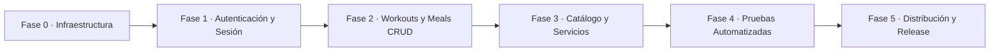

# SOW / Alcance del Proyecto · FitTrack360

## 1. Objetivo

FitTrack360 es una plataforma móvil y backend centralizado diseñada para que personas que entrenan y cuidan su bienestar registren sus sesiones de entrenamiento de fuerza, monitoreen su ingesta calórica y de macronutrientes, y consulten una guía visual de técnica de ejercicios con animaciones GIF, sin pretender sustituir el asesoramiento médico o nutricional profesional.

El sistema se enfoca en resolver la dispersión de herramientas actuales, consolidando en un solo monorepo una experiencia móvil fluida en Flutter y un backend robusto en NestJS respaldado por PostgreSQL.

---

## 2. Tabla de decisiones

| # | Decisión | Alternativa descartada | Por qué | Fecha |
| :--- | :--- | :--- | :--- | :--- |
| **D-01** | **Metodología y cadencia:** Gestión ágil mediante Scrumban con sprints semanales y entregas sincronizadas con los hitos de evaluación académica de la Unidad II de UTEZ. | Scrum tradicional con sprints de 2 a 3 semanas o Kanban puro sin fechas límite. | La duración del cuatrimestre y las entregas parciales semanales (H2 a H7) exigen visibilidad de flujo continuo sin perder la disciplina de entregables fijos por semana. | 2026-10-22 |
| **D-02** | **Servicio en la nube y API externa:** Consumo de USDA FoodData Central (FDC) exclusivamente a través de un proxy en la API de NestJS; credencial protegida en `.env`. | Llamadas HTTP directas desde la aplicación móvil Flutter hacia USDA con la API key incrustada en el código del cliente. | Exponer la API key en el binario del cliente viola el principio de seguridad S3. El proxy centraliza validación, timeouts, transformación de nutrientes y manejo de fallos. | 2026-10-22 |
| **D-03** | **Stack de backend:** NestJS modular con TypeScript, Prisma ORM y base de datos relacional PostgreSQL en contenedor Docker. | Backend en Python con FastAPI o solución Backend-as-a-Service pura basada en Firebase Firestore. | La arquitectura relacional garantiza la integridad de rutinas, sesiones, series compuestas y macronutrientes; NestJS provee inyección de dependencias, DTOs y validación tipada estricta. | 2026-10-22 |
| **D-04** | **Arquitectura móvil:** Flutter con patrón MVVM, gestión de estado con `provider` (`ChangeNotifier`) y componentes modulares bajo Atomic Design. | BLoC / Cubit o arquitectura MVC tradicional sin separación de capas. | `provider` ofrece una curva de implementación predecible y suficiente para el alcance del cuatrimestre, manteniendo la separación entre vistas, ViewModels y repositorios. | 2026-10-22 |
| **D-05** | **Gestión de catálogo y medios de ejercicios:** Catálogo base de 1324 ejercicios precargado en base de datos mediante seed local (`exercises.es.json`) y media (JPG/GIF) servida como recursos estáticos desde NestJS con atribución obligatoria a Gym Visual. | Consulta dinámica mediante web scraping o descarga en caliente desde APIs externas en cada ejecución de la app. | Garantiza funcionamiento determinista, reduce latencia, elimina costos recurrentes y cumple la licencia de atribución de Gym Visual en resolución optimizada de 180x180. | 2026-10-22 |
| **D-06** | **Alcance transaccional y pagos:** Pagos en línea, compras dentro de la app (IAP) y pasarelas de pago quedan formalmente excluidas de la versión v1. | Integración de Stripe o pasarelas de cobro bancario durante el cuatrimestre. | Reduce el riesgo legal y técnico asociado al tratamiento de datos bancarios (PCI-DSS), permitiendo enfocar los esfuerzos en la experiencia central de entrenamiento y nutrición. | 2026-10-22 |

---

## 3. Módulos y fases

### Módulo 1: Infraestructura y Núcleo Compartido (Fase 0)
- Configuración del monorepo con pnpm workspaces y linters unificados.
- Contenedores Docker para PostgreSQL y Mailpit local.
- Prisma ORM configurado con migraciones iniciales.
- Tokens y componentes base del Design System Liquid Glass en Flutter.
- *Entregable:* Entorno de desarrollo local operable con un solo comando (`pnpm dev`).

### Módulo 2: Autenticación, Sesión Segura y Perfil (Fase 1)
- Registro con validación temprana y consentimiento expreso de privacidad (LFPDPPP).
- Inicio de sesión con emisión y rotación de tokens JWT (Access y Refresh).
- Almacenamiento seguro de credenciales con `flutter_secure_storage`.
- Recuperación de contraseña mediante código de 6 dígitos enviado por correo (Mailpit/SMTP).
- Carga de fotografía de perfil o progreso corporal (Capacidad P1).
- *Entregable:* Flujo completo de sesión móvil conectado a la API con protección ante accesos no autenticados.

### Módulo 3: Entrenamientos y Nutrición (Fase 2)
- CRUD de sesiones de entrenamiento (`WorkoutSession`) con detalle de series, repeticiones y cargas (`WorkoutSet`).
- CRUD de registro diario de comidas (`MealLog`) con desglose de alimentos (`MealItem`).
- Registro opcional de ubicación aproximada del gimnasio al finalizar sesión (Capacidad P2).
- Recordatorios locales programados de entrenamiento o comida (Capacidad P3).
- *Entregable:* Usuario capaz de registrar y consultar su historial de entrenamientos y alimentación.

### Módulo 4: Catálogo de Ejercicios y Búsqueda Nutricional (Fase 3)
- Catálogo de 1324 ejercicios con filtros por grupo muscular, equipamiento y objetivo.
- Visualización de instrucciones en español y animación GIF de técnica con atribución a Gym Visual.
- Búsqueda de alimentos conectados a la base de datos de USDA FoodData Central vía proxy.
- Captura manual de alimentos y macronutrientes como mecanismo de degradación.
- Soporte para plantillas de rutinas (`Routine` / `RoutineExercise`).
- *Entregable:* Consulta visual de ejercicios y registro asistido de alimentos con datos nutricionales.

### Módulo 5: Calidad y Pruebas Automatizadas (Fase 4)
- Suite completa de 8 pruebas unitarias en Flutter y API.
- 4 pruebas de widget que validan formularios, estados de carga/error y permiso denegado.
- 1 prueba de integración extremo a extremo del flujo de autenticación y creación de sesión.
- *Entregable:* Ejecución de suite de pruebas automatizadas con salida verde en un solo comando.

### Módulo 6: Empaquetado y Distribución (Fase 5)
- Generación de binarios firmados APK y AAB para Android.
- Configuración de variables de entorno para entornos de producción.
- Expediente de distribución documentado para Google Play, iOS y AppGallery.
- *Entregable:* Entregable final listo para despliegue y defensa técnica de capacidades.

---

## 4. Plan temporal

El cronograma se distribuye en las semanas académicas del cuatrimestre, con asignación directa a los integrantes del equipo:

| Hito | Fase | Alcance principal | Fecha límite | Responsable |
| :--- | :---: | :--- | :--- | :--- |
| **H1** | 0 | Estructura base del monorepo, linters, husky y Docker Compose inicial. | 2026-10-22 | Isael Alejandro Reyes Vargas |
| **H2** | 1 | Autenticación completa, sesión segura, consentimiento de privacidad y foto P1. | 2026-10-30 | Daniela Carrate Bahena |
| **H3** | 2 | CRUD de Workouts y Meals con aislamiento de datos, ubicación P2 y recordatorios P3. | 2026-11-12 | Jafet Bahena González |
| **H4** | 3 | Proxy de USDA FDC, catálogo de ejercicios con GIFs, rutinas y capacidades optativas. | 2026-11-26 | Loreley Carrillo Juárez |
| **H5** | 4 | Suite de pruebas automatizadas (8 unitarias, 4 widget, 1 integración) y scripts de check. | 2026-12-04 | Martin Antonio Joaquín Landa |
| **H6** | 5 | Binarios firmados (APK/AAB), Docker de producción, expediente de tiendas y defensa técnica. | 2026-12-11 | Miguel Ángel Sánchez Pérez |

---

## 5. Gestión de riesgos

| ID | Riesgo identificado | Probabilidad / Impacto | Estrategia de mitigación preventiva | Responsable |
| :--- | :--- | :---: | :--- | :--- |
| **R-01** | La API de USDA FDC presenta latencia elevada (>5 s), agota su cuota de peticiones o queda fuera de servicio. | Media / Alto | La API de NestJS implementa timeout de 5 segundos y fallback automático a modo de captura manual; la app móvil permite capturar nombre, porción y macronutrientes directamente sin bloquear al usuario. | Jafet Bahena González |
| **R-02** | Bloqueo o pérdida de conectividad a internet en instalaciones subterráneas de entrenamiento físico. | Alta / Medio | La aplicación móvil utiliza el componente `connectivity_plus` para detectar la pérdida de red de inmediato, desplegando un banner offline no bloqueante con acción de reintento manual sin cerrar la sesión ni perder datos en captura. | Daniela Carrate Bahena |
| **R-03** | Exposición accidental de credenciales o secretos (API keys de USDA, secrets de JWT, claves SMTP) en el repositorio Git. | Baja / Crítico | Configuración estricta de `.gitignore`, uso de `.env.example` con valores ficticios, bloqueo en hooks de Husky (`pre-commit`) y validación en CI para rechazar commits que incluyan variables reales. | Isael Alejandro Reyes Vargas |

---

## 6. Criterios de aceptación de alto nivel

1. **Rendimiento de autenticación:** Una persona usuaria completa el registro o inicio de sesión en menos de 3 segundos bajo una conexión de datos estándar (4G/Wi-Fi), recibiendo tokens JWT que se almacenan de forma cifrada en el dispositivo.
2. **Consulta ágil de ejercicios:** La lista de ejercicios carga en menos de 500 milisegundos y permite filtrar simultáneamente por grupo muscular (`bodyPart`) y equipamiento (`equipment`), desplegando la animación GIF correspondiente y la atribución a Gym Visual.
3. **Persistencia y aislamiento de entrenamientos:** Un usuario registra una sesión con al menos 3 ejercicios y 4 series por ejercicio, garantizando que un usuario distinto reciba un error `404 Not Found` al intentar acceder a dicho recurso.
4. **Registro nutricional con degradación:** La búsqueda de alimentos mediante USDA FDC devuelve resultados tabulados en menos de 2 segundos; ante desconexión o fallo, la captura manual almacena calorías, proteínas, carbohidratos y grasas en menos de 1 minuto.
5. **Cumplimiento de privacidad LFPDPPP:** La aplicación incluye la casilla obligatoria de aceptación de aviso de privacidad en el registro y provee en Ajustes las opciones de descarga de datos (exportación JSON) y eliminación definitiva de la cuenta en cascada.
6. **Cobertura y estabilidad de pruebas:** El comando de testing ejecuta satisfactoriamente un mínimo de 8 pruebas unitarias, 4 pruebas de widget (incluyendo estado de permiso denegado) y 1 prueba de integración sin intervenciones manuales.

---

## 7. Fuera de alcance

- **Procesamiento de pagos y suscripciones:** No se integrarán pasarelas bancarias, billeteras digitales ni modelos freemium de cobro (D-06).
- **Diagnóstico y prescripción clínica:** El sistema no calcula dietas médicas ni emite recetas o planes clínicos para patologías específicas; se incluye un descargo de responsabilidad visible en la aplicación.
- **Generación de rutinas por Inteligencia Artificial:** No se conectarán modelos LLM para la creación automatizada de entrenamientos en la versión v1.
- **Compilación de instalador para iOS (IPA):** Por restricciones de licencias de desarrollador y equipamiento macOS en el entorno académico, la entrega para iOS se limitará a documentación técnica y expediente de arquitectura.
- **Sincronización multi-dispositivo en tiempo real (WebSockets):** La comunicación cliente-servidor se realiza mediante peticiones REST idempotentes; no se implementará sincronización bidireccional continua.

---

## 8. Documentos del proyecto

En cumplimiento con la estructura del proyecto integrador, la siguiente tabla detalla la pertinencia de cada documento técnico dentro del monorepo:

| Documento | Ruta | ¿Aplica al proyecto? | Justificación |
| :--- | :--- | :---: | :--- |
| **SOW / Alcance** | `docs/specs/01-alcance.md` | **Sí** | Obligatorio. Define objetivos, decisiones, fases, plan temporal, riesgos y límites del sistema. |
| **PRD / Producto** | `docs/specs/02-prd.md` | **Sí** | Obligatorio. Especifica las historias de usuario con criterios comprobables, requisitos no funcionales y necesidades del usuario. |
| **Integraciones** | `docs/specs/03-integraciones.md` | **Sí** | Requerido. FitTrack360 consume la API externa de USDA FDC, servicios SMTP de correo, almacenamiento de imágenes y catálogo multimedia de Gym Visual. |
| **Arquitectura** | `docs/specs/04-arquitectura.md` | **Sí** | Requerido. Describe la interacción entre cliente Flutter, backend NestJS, persistencia PostgreSQL, proxies seguros y estrategia de aislamiento de datos. |
| **Modelo de datos** | `docs/specs/05-datos.md` | **Sí** | Requerido. El dominio maneja múltiples entidades relacionales interconectadas (`User`, `WorkoutSession`, `WorkoutSet`, `MealLog`, `MealItem`, `Exercise`, `Photo`). |
| **Convenciones** | `docs/specs/06-convenciones.md` | **Sí** | Obligatorio. Estandariza la estructura del código, patrones MVVM y por capas, guías de estilo, Conventional Commits y estrategia de pruebas. |
