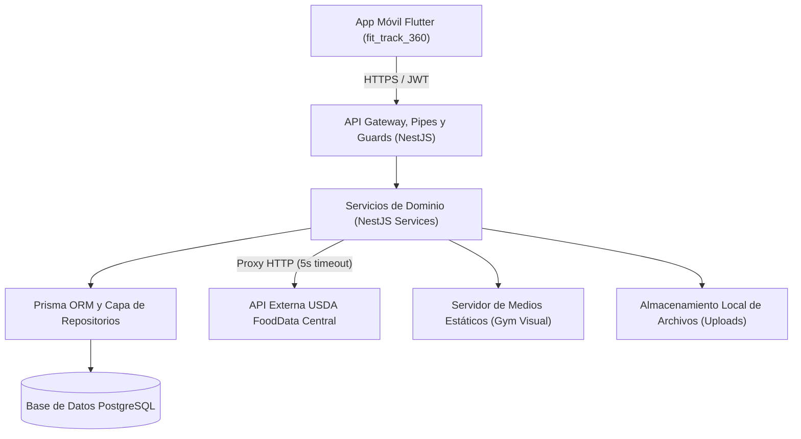

# ARQUITECTURA · Decisiones de Sistema y Aislamiento · FitTrack360

## 1. Propósito

Este documento establece la arquitectura global del sistema FitTrack360, detallando la interacción entre la aplicación móvil, los componentes del backend, la capa de persistencia y los servicios externos. Asimismo, define las directrices de escalabilidad y las políticas de aislamiento para salvaguardar la privacidad de los usuarios y la integridad de los datos de entrenamiento y nutrición.

---

## 2. Tabla de decisiones de sistema

| # | Decisión | Alternativa descartada | Por qué | Fecha |
| :--- | :--- | :--- | :--- | :--- |
| **A-01** | **Monorepo gestionado con pnpm workspaces:** Consolidar cliente móvil (`fit_track_360`) y backend (`fit_track_api`) en un único repositorio Git. | Repositorios separados (multirepo) para frontend y backend. | Simplifica la orquestación local con Docker, unifica los contratos de API y evita discrepancias de versionado durante el ciclo de desarrollo acelerado del cuatrimestre. | 2026-10-22 |
| **A-02** | **Comunicación estrictamente REST sobre HTTPS:** Toda interacción cliente-servidor se realiza mediante endpoints HTTP stateless con autenticación Bearer JWT. | Arquitectura orientada a eventos con WebSockets o GraphQL. | La naturaleza de la aplicación (registro de sesiones de ejercicio, consulta de catálogo y comidas) no demanda suscripciones bidireccionales continuas; REST ofrece mayor simplicidad, cacheabilidad y menor consumo de batería en el móvil. | 2026-10-22 |
| **A-03** | **Aislamiento por identidad con respuesta 404 (Regla S4):** Toda consulta a un recurso que pertenezca a otro usuario responde `404 Not Found` en lugar de `403 Forbidden`. | Devolver código de error `403 Forbidden` ante intentos de acceso no autorizados. | Responder `403` revela a un atacante que el recurso existe en la base de datos (fuga de metadatos); responder `404` oculta totalmente la existencia del registro ajeno. | 2026-10-22 |
| **A-04** | **Sanitización de imágenes en el servidor:** Las fotos de progreso corporal y comidas subidas por el usuario son procesadas con la biblioteca `sharp` para eliminar metadatos EXIF y coordenadas GPS antes de almacenarlas. | Guardar las imágenes directamente en el sistema de archivos tal como llegan desde el dispositivo móvil. | Protege la privacidad física del usuario eliminando la ubicación geográfica exacta donde se tomó la fotografía y reduce el tamaño de almacenamiento en disco. | 2026-10-22 |

---

## 3. Cómo se compone el sistema

El sistema está articulado en componentes especializados desacoplados según el siguiente diagrama:

### Descripción de componentes (8 nodos)
1. **App Móvil Flutter (`fit_track_360`):** Cliente para Android e iOS desarrollado en Flutter que proporciona la interfaz de usuario bajo Atomic Design y orquesta la lógica de presentación con MVVM.
2. **API Gateway, Pipes y Guards (NestJS):** Punto de entrada del backend que gestiona el enrutamiento `/api/v1`, valida DTOs de entrada con `class-validator`, aplica limitación de tasa (*rate limit*) y verifica tokens JWT con `JwtAuthGuard`.
3. **Servicios de Dominio (NestJS Services):** Módulos que encapsulan las reglas de negocio para autenticación, gestión de entrenamientos, conteo de macronutrientes y proxies a servicios externos.
4. **Prisma ORM y Capa de Repositorios:** Abstracción tipada para la construcción de consultas SQL seguras con protección automática contra inyecciones SQL y soporte para migraciones versionadas.
5. **Base de Datos PostgreSQL:** Motor de base de datos relacional que garantiza persistencia transaccional (ACID) para usuarios, historiales de ejercicio, métricas corporales y catálogo base.
6. **API Externa USDA FoodData Central:** Proveedor externo de datos nutricionales consumido de forma controlada a través de un proxy para búsqueda de alimentos en inglés.
7. **Servidor de Medios Estáticos (Gym Visual):** Módulo `@nestjs/serve-static` encargado de servir eficientemente las 1324 imágenes y GIFs de ejercicios en modo solo lectura.
8. **Almacenamiento Local de Archivos (Uploads):** Driver de almacenamiento en disco (`StorageService`) configurado en la carpeta `fit_track_api/uploads/` para resguardar las fotos privadas de progreso y comidas.

---

## 4. Cómo escala el sistema

### Cuellos de botella potenciales y soluciones
1. **Consultas sobre el catálogo de ejercicios (1324 registros):**
   - *Solución:* Implementación de paginación mediante `take` y `skip` en el endpoint `GET /api/v1/exercises`, acompañada de filtros indexados sobre `bodyPart`, `equipment` y `target`. En el cliente, la app mantiene en memoria local la lista precargada durante la sesión activa.
2. **Consumo de medios estáticos (GIFs animados de ejercicios):**
   - *Solución:* Los archivos se encuentran optimizados a 180x180 px (~100 KB por GIF). Para un volumen de usuarios mayor, la carpeta `public/exercises/` puede montarse detrás de un reverse proxy (como NGINX o Caddy) o delegarse a una red de distribución de contenidos (CDN) como Cloudflare sin alterar el código de la API.
3. **Consultas a la API de USDA FDC:**
   - *Solución:* El endpoint `GET /api/v1/foods/search` cuenta con *throttling* para prevenir abusos de cuota. Además, los alimentos consultados que se asignan a un registro de comida (`MealItem`) se copian íntegramente en la base de datos PostgreSQL, evitando consultas recurrentes a USDA para mostrar el historial pasado del usuario.

### Qué NO se optimiza prematuramente
- No se implementa una capa de caché distribuida en memoria (como Redis) ni replicación maestro-esclavo de PostgreSQL para la versión inicial, priorizando la simplicidad operativa y la confiabilidad del monorepo en un único nodo Docker.

---

## 5. Cómo se aísla el sistema (Seguridad y Privacidad)

### Autenticación y Autorización
- **Tokens criptográficos JWT:**
  - Token de acceso (*Access Token*): Vida útil corta de **15 minutos**, firmado con clave secreta asimétrica o HMAC-SHA256 (`JWT_ACCESS_SECRET`).
  - Token de refresco (*Refresh Token*): Vida útil de **7 días** (`JWT_REFRESH_SECRET`), almacenado en PostgreSQL hasheado en la tabla `RefreshToken` y sujeto a rotación obligatoria en cada solicitud de refresco. Al cerrar sesión (*logout*), el token se revoca inmediatamente.
- **Autorización por propiedad (`userId`):**
  - Todas las consultas de lectura, actualización y borrado en `WorkoutSession`, `MealLog`, `BodyMetric` y `Photo` incluyen obligatoriamente el predicado `where: { id, userId: req.user.id }`.
  - Si un usuario solicita un identificador que no le pertenece, el servicio lanza un `NotFoundException` (Regla S4), asegurando que un atacante no pueda inferir la existencia de registros de otros usuarios.

### Protección de secretos y variables de entorno
- Los secretos (`DATABASE_URL`, `JWT_ACCESS_SECRET`, `JWT_REFRESH_SECRET`, `USDA_FDC_API_KEY`) residen exclusivamente en variables de entorno inyectadas por Docker o archivos locales `.env` no versionados.
- El cliente móvil Flutter nunca almacena secretos de backend ni llaves de API externas; únicamente preserva los tokens JWT propios de la sesión del usuario en `flutter_secure_storage`.

### Privacidad y Cumplimiento Normativo (LFPDPPP y Derechos ARCO)
- **Consentimiento informado:** Se registra en la base de datos la fecha y hora exacta (`privacyConsentAt`) y la versión aceptada (`privacyNoticeVersion`) al momento de crear la cuenta.
- **Derecho de Acceso (Exportación):** Endpoint `GET /api/v1/users/me/export` que genera un archivo JSON con toda la información histórica, médica y nutricional acumulada por el usuario.
- **Derecho de Cancelación (Borrado en cascada):** Endpoint `DELETE /api/v1/users/me` que elimina definitivamente al usuario y borra recursivamente mediante cascada sus sesiones de entrenamiento, registros de comidas, métricas y archivos físicos del sistema de almacenamiento.
- **Deslinde de responsabilidad:** Toda vista de nutrición y entrenamiento incluye la notificación legal de que FitTrack360 es una herramienta de registro de actividad y no emite prescripciones médicas ni dietoterapéuticas.
