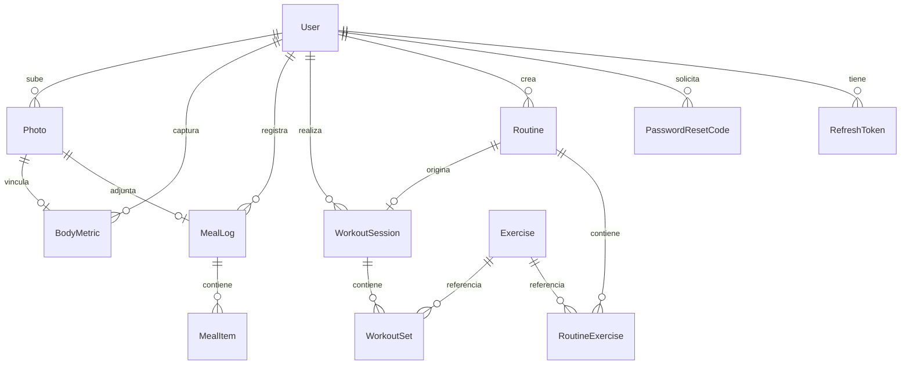

# MODELO DE DATOS · Esquema Conceptual y Reglas Transversales · FitTrack360

## 1. Propósito

Este documento define la estructura conceptual de datos, las relaciones entre entidades y las reglas transversales de persistencia que rigen la base de datos PostgreSQL de FitTrack360 a través de Prisma ORM.

---

## 2. Tabla de decisiones de modelo de datos

| # | Decisión | Alternativa descartada | Por qué | Fecha |
| :--- | :--- | :--- | :--- | :--- |
| **M-01** | **Identificadores UUID v4 para entidades transaccionales y String para catálogo:** Los usuarios, sesiones, comidas y fotos utilizan UUID generados automáticamente; los ejercicios del catálogo usan identificadores String con padding numérico (ej. `"0001"`). | Usar enteros autoincrementales (`SERIAL` / `BIGINT`) para todas las tablas. | Los enteros secuenciales son predecibles y vulnerables a ataques de enumeración (IDOR) en endpoints públicos; los identificadores del catálogo conservan la nomenclatura original del dataset de Gym Visual. | 2026-10-22 |
| **M-02** | **Copia desnormalizada de nutrientes en `MealItem`:** Al registrar un alimento de USDA o captura manual, los macronutrientes (`kcal`, `proteinG`, `carbsG`, `fatG`) se copian y congelan en la fila del registro. | Guardar únicamente una llave foránea hacia un catálogo centralizado de alimentos de USDA. | Asegura que el historial de ingesta del usuario no cambie retrospectivamente si el dataset de USDA actualiza sus valores o si el alimento es renombrado o eliminado de la fuente externa. | 2026-10-22 |
| **M-03** | **Almacenamiento de contraseñas con Argon2id:** Las contraseñas se almacenan como hashes criptográficos con salt generado por `@node-rs/argon2`. | Utilizar bcrypt o SHA-256 tradicional sin funciones resistentes a memoria. | Argon2id es el algoritmo estándar recomendado por OWASP y el NIST para protección contra ataques masivos de fuerza bruta y hardware acelerado (ASIC/GPU). | 2026-10-22 |
| **M-04** | **Metadatos de fotos desacoplados del binario:** La tabla `Photo` almacena únicamente metadatos técnicos (`storageKey`, `mimeType`, `sizeBytes`, `width`, `height`, `userId`), mientras que el archivo binario reside en el sistema de almacenamiento. | Almacenar imágenes completas en la base de datos como campos binarios (`BYTEA` o `BLOB`). | Evita la degradación del rendimiento de PostgreSQL, reduce el tamaño de los respaldos de base de datos y permite una entrega de archivos más eficiente a través del sistema de archivos. | 2026-10-22 |

---

## 3. Diagrama Entidad-Relación Conceptual (Mermaid)

---

## 4. Diccionario breve de entidades

| Entidad | Qué representa en el negocio | Quién la crea | Quién la lee |
| :--- | :--- | :--- | :--- |
| **`User`** | Cuenta de usuario del sistema, credenciales de acceso, datos de perfil y consentimiento de privacidad. | El usuario mediante `POST /auth/register`. | El propio usuario en `GET /users/me` y los servicios internos de autenticación. |
| **`RefreshToken`** | Token criptográfico de sesión extendida para renovación de tokens de acceso sin requerir credenciales continuas. | La API de autenticación al iniciar sesión o refrescar token. | El servicio `AuthService` para verificar vigencia y revocación. |
| **`PasswordResetCode`** | Código numérico de un solo uso de 6 dígitos con vigencia temporal para recuperación de contraseña. | El usuario mediante `POST /auth/password/forgot`. | El servicio `AuthService` al validar el reseteo con `POST /auth/password/reset`. |
| **`Exercise`** | Ejercicio físico del catálogo precargado con nombres, grupo muscular, equipamiento, instrucciones y media visual. | El script de seed del sistema (`prisma/seed.ts`). | Todos los usuarios autenticados mediante `GET /exercises`. |
| **`Routine`** | Plantilla de entrenamiento personalizada creada por el deportista para estructurar sus días de ejercicio. | El usuario autenticado en `POST /routines`. | Únicamente el usuario creador (`userId`). |
| **`RoutineExercise`** | Elemento individual dentro de una rutina que especifica posición, series objetivo y repeticiones planeadas. | El usuario al configurar los ejercicios de su rutina. | El usuario al consultar el detalle de su plantilla. |
| **`WorkoutSession`** | Registro histórico de una sesión de entrenamiento ejecutada con fecha de inicio, término y notas. | El usuario al completar un entrenamiento en `POST /workouts`. | El propio usuario en su historial y resumen de Home. |
| **`WorkoutSet`** | Serie completada en un ejercicio específico con repeticiones logradas y peso levantado en kilogramos. | El usuario al ingresar los datos de cada serie. | El usuario al inspeccionar el desglose de su sesión. |
| **`MealLog`** | Registro de ingesta alimenticia diaria clasificada por tipo de comida (desayuno, almuerzo, cena, colación). | El usuario en `POST /meals`. | El usuario al consultar su registro calórico del día. |
| **`MealItem`** | Alimento específico consumido dentro de una comida con gramos de porción y desglose de macronutrientes. | El usuario al buscar en USDA o ingresar captura manual. | El usuario en el desglose de calorías y macros. |
| **`BodyMetric`** | Registro temporal de medidas antropométricas corporales (peso en kg, porcentaje de grasa, cintura en cm). | El usuario en `POST /progress/metrics`. | El usuario en los gráficos de evolución de progreso. |
| **`Photo`** | Metadatos y referencia de almacenamiento de una fotografía privada de progreso corporal o comida. | El usuario mediante carga multipart en `POST /photos`. | Únicamente el usuario dueño de la fotografía (`userId`). |

---

## 5. Reglas transversales de datos

1. **Fechas y marcas temporales en UTC (ISO 8601):**
   - Todos los campos de fecha y hora (`createdAt`, `updatedAt`, `startedAt`, `endedAt`, `eatenAt`, `measuredAt`, `privacyConsentAt`) se almacenan en UTC con formato estándar `YYYY-MM-DDTHH:mm:ss.sssZ`. La conversión a huso horario local se realiza exclusivamente en la capa de presentación de la aplicación móvil.

2. **Propiedad y control de acceso (`ownership`):**
   - Todas las entidades del usuario (`WorkoutSession`, `MealLog`, `Routine`, `BodyMetric`, `Photo`, `RefreshToken`, `PasswordResetCode`) contienen una clave foránea `userId` no nula indexada que referencia al modelo `User`.

3. **Integridad referencial y borrado en cascada (`ON DELETE CASCADE`):**
   - Si un usuario ejerce su derecho ARCO de cancelación y se elimina su cuenta (`DELETE /users/me`), la base de datos elimina de manera automática y atómica todos sus tokens, rutinas, entrenamientos, comidas, métricas y metadatos de fotos asociados, impidiendo registros huérfanos.

4. **Inmutabilidad de datos nutricionales pasados:**
   - Una vez insertado un `MealItem`, sus campos calóricos y de macronutrientes son inmutables respecto a cambios en la fuente externa de USDA FDC. Esto preserva la exactitud histórica de los reportes pasados del usuario.

5. **Protección y cifrado de datos personales:**
   - La columna `passwordHash` almacena la cadena generada por Argon2id; nunca se admite texto plano.
   - Los tokens de refresco y códigos de recuperación se almacenan bajo hash SHA-256 (`tokenHash`, `codeHash`).
   - Los datos de correo electrónico y nombre de usuario cuentan con restricciones de unicidad (`@unique`) y se normalizan en minúsculas antes de la persistencia para evitar duplicidades por diferencias de mayúsculas.
