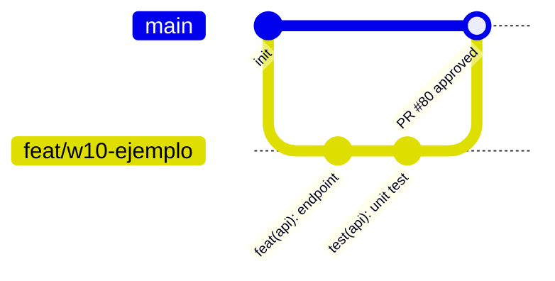

# CONVENCIONES · Estándares de Código, Flujo Git y Testing · FitTrack360

## 1. Propósito

Este documento establece los acuerdos de ingeniería, estándares de calidad, convenciones de Git y patrones arquitectónicos que deben seguir todas las personas e integraciones que colaboren en el monorepo FitTrack360. El objetivo es garantizar que cualquier integrante pueda continuar, revisar o auditar el trabajo de otra persona sin fricción ni discrepancias de estilo.

---

## 2. Tabla de decisiones de convenciones

| # | Decisión | Alternativa descartada | Por qué | Fecha |
| :--- | :--- | :--- | :--- | :--- |
| **C-01** | **Ramas especializadas por tarea con prefijo estandarizado:** Creación de ramas independientes (`feat/...`, `fix/...`, `docs/...`, `chore/...`, `test/...`) prohibiendo *commits* directos en `main`. | Trabajar directamente sobre la rama `main` o en ramas personales de larga duración. | Aísla los cambios, permite revisiones atómicas mediante Pull Requests y mantiene la rama `main` siempre estable y desplegable. | 2026-10-22 |
| **C-02** | **Formato estricto de Conventional Commits:** Mensajes con estructura `<type>(<scope>): <mensaje>` en imperativo y minúsculas validado por hooks de Git. | Mensajes libres e informales como "arreglos", "subiendo cambios" o "update". | Genera un historial autodescriptivo que facilita auditorías, generación de changelogs y trazabilidad directa a los requerimientos del cuatrimestre. | 2026-10-22 |
| **C-03** | **Revisión obligatoria por pares para merge a `main`:** Ningún Pull Request se fusiona sin la aprobación explícita de al menos una persona distinta de quien abrió el PR. | Auto-aprobar y fusionar los propios cambios sin revisión. | Fomenta la responsabilidad compartida, detecta defectos tempranamente y verifica que la persona asignada al rol de Revisión certifique los estándares. | 2026-10-22 |
| **C-04** | **Enforcement automatizado con Husky en pre-commit y pre-push:** Verificación local obligatoria de linters (`oxlint`, `dart analyze`), formateadores (`prettier`, `dart format`) y compilación de tipos (`tsc --noEmit`). | Confiar únicamente en la disciplina manual de cada desarrollador antes de hacer push. | Bloquea código defectuoso en el origen antes de que llegue al repositorio remoto, garantizando calidad sin depender de la memoria humana. | 2026-10-22 |
| **C-05** | **Política de corrección de bugs con prueba asociada:** Todo error reportado y corregido debe incluir la prueba automatizada que lo detecta y previene su regresión. | Corregir únicamente la línea de código afectada sin agregar tests complementarios. | Evita que errores previamente resueltos reaparezcan en refactorizaciones futuras, consolidando una suite de pruebas robusta. | 2026-10-22 |

---

## 3. Organización del repositorio

Estructura real del monorepo a dos niveles:

```text
fit-track-360-monorepo/
├── .husky/                     # Hooks de Git (pre-commit, commit-msg, pre-push)
├── docs/                       # Documentación técnica, planeación y especificaciones
│   ├── context/                # Enunciados, rúbricas y requerimientos académicos
│   ├── copy/                   # Textos de autenticación y aviso de privacidad
│   ├── ia/                     # Bitácora de uso de asistentes de IA
│   ├── planeacion/             # Caso de estudio y arquitectura de alto nivel
│   ├── plans/                  # Plan maestro de FitTrack360 (roadmap y arquitectura)
│   └── specs/                  # Especificaciones de la integradora (SOW, PRD, arquitectura, datos, etc.)
├── fit_track_360/              # Aplicación móvil en Flutter
│   ├── android/                # Configuración nativa y manifiesto de Android
│   ├── ios/                    # Configuración nativa y Runner de iOS
│   ├── lib/                    # Código fuente Dart (core, design_system, features)
│   └── test/                   # Pruebas unitarias, de widgets y dobles de prueba
├── fit_track_api/              # Backend REST en NestJS
│   ├── prisma/                 # Esquema Prisma, migraciones y seed de base de datos
│   ├── public/                 # Assets multimedia de ejercicios (imágenes y GIFs)
│   ├── seed/                   # Dataset JSON de ejercicios en español
│   ├── src/                    # Código fuente TypeScript (auth, mail, prisma, storage, users)
│   └── test/                   # Pruebas unitarias, de integración y e2e con Jest
├── scripts/                    # Scripts de desarrollo y menú interactivo dev
├── .gitignore                  # Exclusiones globales de Git (secretos, builds, node_modules)
├── package.json                # Configuración raíz de scripts del monorepo con pnpm
├── pnpm-lock.yaml              # Bloqueo determinista de dependencias Node.js
├── pnpm-workspace.yaml         # Definición del workspace monorepo
└── README.md                   # Guía de arranque, roles del equipo y comandos generales
```

---

## 4. Patrones de diseño seleccionados

### En Frontend (`fit_track_360` - Flutter)
- **MVVM (Model-View-ViewModel):**
  - *Vista (Pages/Widgets):* Componentes visuales declarativos que escuchan al ViewModel y no contienen lógica de negocio ni llamadas directas a APIs.
  - *ViewModel:* Clases basadas en `ChangeNotifier` que gestionan el estado reactivo, encapsulan flujos asíncronos y exponen propiedades observables mediante `provider`.
  - *Modelo (Entities):* Clases inmutables de dominio sin acoplamiento a librerías externas.
- **Patrón Repositorio (Repository Pattern):**
  - Define interfaces abstractas en la capa de dominio (`domain/repositories/`) implementadas en la capa de datos (`data/repositories/`). Permite sustituir la fuente de datos real por dobles (*mocks*) en las pruebas unitarias y de widget.
- **Atomic Design:**
  - Estructuración de componentes visuales en `atoms/` (tokens, botones base), `molecules/` (campos de texto estilizados, tiles), `organisms/` (tarjetas compuestas, cabeceras) y `templates/` (plantillas de pantalla completa).

### En Backend (`fit_track_api` - NestJS)
- **Clean Architecture / Arquitectura por Capas:**
  - *Controllers:* Manejan peticiones HTTP, rutas, códigos de estado y documentación OpenAPI/Swagger.
  - *Services:* Concentran la lógica de negocio, validaciones transaccionales y orquestación de llamadas.
  - *Prisma Repositories / Services:* Abstracción de acceso a datos que ejecuta consultas seguras y migraciones sobre PostgreSQL.
- **Inyección de Dependencias (DI):**
  - Uso nativo del contenedor IoC de NestJS para inyectar servicios en controladores y repositorios, posibilitando pruebas aisladas con mocks de Jest.
- **Data Transfer Objects (DTO) con Validación Declarativa:**
  - Validación estricta de payloads con `class-validator` y `class-transformer` ejecutada globalmente con `ValidationPipe({ whitelist: true, forbidNonWhitelisted: true })`.

---

## 5. Patrones de código y formato

### Convenciones en Flutter (Dart)
- Nombres de archivos en `snake_case`: `workout_session_page.dart`, `exercise_repository.dart`.
- Nombres de clases en `UpperCamelCase`: `WorkoutSessionViewModel`, `DsTextField`.
- Nombres de variables y funciones en `lowerCamelCase`: `isLoading`, `fetchExercises()`.
- Estructura por funcionalidad en `features/<feature>/`:
  - `data/` (modelos, datasources remotos/locales, implementaciones de repositorios).
  - `domain/` (entidades puras, contratos de repositorios).
  - `presentation/` (pantallas, ViewModels y widgets privados).

### Convenciones en NestJS (TypeScript)
- Nombres de archivos con sufijo identificador: `auth.controller.ts`, `auth.service.ts`, `register.dto.ts`.
- Módulos autocontenidos en `src/<modulo>/`.
- Respuestas tipadas con DTOs de salida para evitar fugas de campos internos (ej. `passwordHash`).
- Rutas REST en plural y minúsculas: `/api/v1/exercises`, `/api/v1/workouts`.

---

## 6. Estrategia de testing

La suite de pruebas garantiza la estabilidad del sistema y se ejecuta con comandos verificables:

| Ámbito | Herramienta | Comando de ejecución | Qué valida |
| :--- | :--- | :--- | :--- |
| **Monorepo Lint** | Oxlint / Dart Analyzer | `pnpm run lint` | Ausencia de advertencias y errores estáticos en Flutter y NestJS. |
| **Monorepo Formato** | Prettier / Dart Format | `pnpm run format:check` | Cumplimiento del espaciado, saltos de línea y estilo de código. |
| **Monorepo Tipos** | TypeScript Compiler | `pnpm run typecheck:api` | Tipado estricto sin errores de compilación en el backend. |
| **API Pruebas** | Jest | `pnpm --dir fit_track_api run test` | 8 pruebas unitarias sobre servicios de autenticación, usuarios y catálogo. |
| **Flutter Pruebas** | Flutter Test | `flutter test -C fit_track_360` | Pruebas unitarias de ViewModels, validadores y pruebas de widgets. |

### Regla de oro ante defectos (Bugfix Rule)
Si se descubre un defecto en cualquier ambiente, la persona asignada debe escribir primero una prueba que reproduzca el fallo en rojo (*red*), aplicar la corrección hasta que la prueba pase a verde (*green*), y subir ambos cambios juntos en el mismo Pull Request.

---

## 7. Flujo de trabajo con Git



1. **Creación de rama:**
   - Asegurarse de tener `main` actualizada: `git checkout main && git pull`.
   - Crear rama descriptiva: `git checkout -b <tipo>/<alcance>-<descripcion>` (ej. `feat/w10-exercise-catalog`).
2. **Desarrollo y commits atómicos:**
   - Realizar commits incrementales respetando Conventional Commits:
     ```text
     feat(workouts): agregar calculo de volumen total en sesion
     fix(auth): corregir mensaje de error ante correo duplicado
     docs(specs): actualizar diagrama de arquitectura
     ```
3. **Verificación local previa:**
   - Ejecutar `pnpm run lint` y pruebas antes de intentar push.
4. **Pull Request y Revisión:**
   - Abrir PR hacia `main` detallando qué se hizo y cómo probarlo.
   - Solicitar revisión a otro integrante del equipo.
   - Una vez aprobado y con los checks en verde, fusionar mediante *Squash and merge* o *Merge commit* según la directriz del repositorio.

---

## 8. Al clonar (Guía paso a paso)

Para levantar el proyecto completo desde un clon limpio en una nueva máquina:

```bash
# 1. Clonar el repositorio privado
git clone https://github.com/AlexReyes03/FitTrack360-temporal.git
cd FitTrack360-temporal

# 2. Instalar dependencias del monorepo y configurar hooks de Husky
pnpm install

# 3. Configurar variables de entorno del backend
cp fit_track_api/.env.example fit_track_api/.env

# 4. Iniciar entorno interactivo de desarrollo (levanta Postgres, migraciones y app)
pnpm dev

# 5. O levantar servicios manualmente:
# En una terminal para base de datos y migraciones:
cd fit_track_api
docker compose up -d postgres
npx prisma migrate dev
npx prisma db seed

# En otra terminal para la app móvil:
cd ../fit_track_360
flutter run
```
